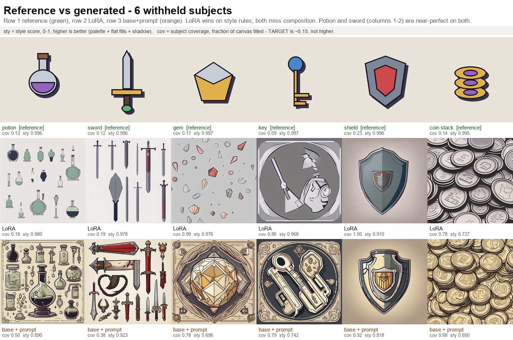

# SDXL LoRA on SageMaker: style consistency for art assets

An end-to-end reference implementation for training, evaluating, versioning
and serving a style LoRA on Amazon SageMaker.

The problem it addresses: when art style is expressed through prompts and
inference-time conditioning, style is a *suggestion* the model can drift from.
In an iterative loop each pass re-interprets it slightly differently, so error
compounds. A LoRA moves style from the prompt into the weights — it stops
being something you ask for and becomes something the model is.

The second argument matters more in production: **a LoRA is a file.** It can
be versioned, reviewed, approved, and pinned to a project. "House style v1.2"
becomes a real artifact instead of a prompt convention that every contributor
tweaks slightly.

## Measured outcome

Against held-out reference art the model never saw during training:

| | base + prompt engineering | base + LoRA |
|---|---|---|
| style score, single generation | 0.866 | **0.984** |
| style score, holdout mean | 0.786 | **0.923** |
| spread across 5 iterative passes | 0.194 | **0.039** (4.9x tighter) |

Cost: roughly **$2.60** and 100 minutes per training run on a single GPU
instance.



*Six withheld reference images (top), the LoRA's output (middle), and the base
model with careful prompt engineering (bottom). The LoRA wins on style rules;
neither controls composition — see
[Holdout evaluation](#holdout-evaluation-the-result-that-keeps-this-honest).*

---

## Getting started

### What you need

| | |
|---|---|
| An AWS account | with SageMaker available in your chosen region |
| GPU quota | at least 1 × `ml.g5.2xlarge` for training **and** 1 for endpoints |
| An IAM role | that SageMaker can assume, with `AmazonSageMakerFullAccess` |
| Python | 3.10 or newer, locally |
| Budget | ~$2.60 per training run, plus ~$1.50/hr while an endpoint is up |

You do **not** need a SageMaker Studio domain. These scripts run from any
machine with AWS credentials; only the training and inference jobs run in
SageMaker.

### 1. Configure your AWS account

Nothing account-specific is committed to this repo. **Your account ID is never
written into any file** — it is resolved at runtime from whichever credentials
you are using, via `sts:GetCallerIdentity`.

So there is nowhere to "put your account number". You just need working
credentials:

```bash
aws configure
# or, if you use IAM Identity Center / SSO:
aws sso login --profile my-profile
export AWS_PROFILE=my-profile
```

Confirm which account you are pointed at:

```bash
aws sts get-caller-identity
```

### 2. Create or find an execution role

This is the one piece of setup you must supply, because SageMaker assumes a
role to run training jobs and endpoints on your behalf. Your own user
credentials are not enough.

**Do you already have one?** Most accounts that have touched SageMaker do:

```bash
aws iam list-roles \
  --query "Roles[?contains(RoleName,'SageMaker')].[RoleName,Arn]" \
  --output table
```

**If not, create one** (needs IAM permissions):

```bash
aws iam create-role --role-name SageMakerExecutionRole \
  --assume-role-policy-document '{
    "Version": "2012-10-17",
    "Statement": [{
      "Effect": "Allow",
      "Principal": {"Service": "sagemaker.amazonaws.com"},
      "Action": "sts:AssumeRole"
    }]
  }'

aws iam attach-role-policy --role-name SageMakerExecutionRole \
  --policy-arn arn:aws:iam::aws:policy/AmazonSageMakerFullAccess
```

`AmazonSageMakerFullAccess` is broad and includes S3 access to buckets whose
names contain `sagemaker`. For production, scope it down to the specific
bucket and actions you need.

### 3. Set your environment

```bash
cp .env.example .env
```

Edit `.env` and set at minimum:

```bash
AWS_REGION=us-east-2
SAGEMAKER_ROLE_ARN=arn:aws:iam::<your-account-id>:role/SageMakerExecutionRole
```

The role ARN is the only place your account ID appears, and `.env` is
gitignored. Then load it:

```bash
set -a; source .env; set +a      # macOS / Linux / Git Bash
```

```powershell
Get-Content .env | Where-Object { $_ -match '^\s*[^#]' } | ForEach-Object {
    $k, $v = $_ -split '=', 2
    [Environment]::SetEnvironmentVariable($k.Trim(), $v.Trim(), 'Process')
}
```

Optional, and only needed for the MLflow steps (7, 8, 13, 17-20, 22):

```bash
MLFLOW_TRACKING_SERVER=<name>    # aws sagemaker list-mlflow-tracking-servers
```

A tracking server costs roughly $0.64/hr while running. Skip it if you only
want the training and evaluation path.

### 4. Check before you spend anything

```bash
pip install -r requirements.txt
python scripts/00_preflight.py
```

This is read-only and creates nothing. It verifies your credentials, lists
GPU quota for both training and endpoints, and finds roles SageMaker can
assume. **If quota shows 0 for `ml.g5.2xlarge`, stop here** and request an
increase in Service Quotas, or set `INSTANCE_TYPE` to something you do have.
New accounts frequently have no GPU quota at all, and a training job will sit
in `Pending` rather than failing with a clear message.

### 5. Run the pipeline

```bash
python scripts/01_generate_dataset.py   # synthetic corpus + holdout, local
python scripts/03_launch_training.py    # ~100 min, ~$2.60
python scripts/04_job_status.py         # poll; prints recent jobs if no args
python scripts/05_deploy_endpoint.py    # ~12 min to InService
python scripts/06_compare.py --endpoint <endpoint-name>
python scripts/09_evaluate_holdout.py --endpoint <endpoint-name> --baseline
```

Most scripts default to your most recent completed training job, so you can
usually omit `--job-name`.

### 6. Clean up — this one matters

```bash
python scripts/99_cleanup.py --all-lora
```

Endpoints bill continuously whether used or not, roughly **$36/day** for a
single GPU instance. Training jobs stop charging when they finish; endpoints
do not. Run with no arguments first to list what is live without deleting
anything.

### Try it without touching AWS

Steps 1, 2, 15 and 21 run entirely locally. If you want to see the synthetic
style corpus and how the metrics work before committing any spend:

```bash
pip install Pillow numpy
python scripts/01_generate_dataset.py
python scripts/02_style_metrics.py      # training images should score ~0.996
```

### Troubleshooting

| symptom | cause |
|---|---|
| `No region configured` | set `AWS_REGION` or run `aws configure` |
| `No execution role found` | set `SAGEMAKER_ROLE_ARN`; see step 2 |
| Training job stuck in `Pending` | no GPU quota; check `00_preflight.py` |
| `ResourceLimitExceeded` | quota is lower than requested instance count |
| `No MLflow tracking server configured` | set `MLFLOW_TRACKING_SERVER`, or skip the MLflow steps |
| Console shows no tracking servers | check the account menu matches `aws sts get-caller-identity`; the console and CLI can be signed into different accounts |
| `image_uris` import error | SageMaker SDK v3 installed; this repo needs `>=2.230,<3` |

## Why the training data is procedural, not model-generated

The obvious shortcut is to generate the training set with SDXL using heavy
style prompting. Don't. If the base model can already produce the style from a
prompt, the A/B comparison is circular — you have proved only that the model
can reproduce something it already knew.

Instead `style/` draws the corpus **with code**: a locked 12-colour palette,
fixed outline weight, hard offset shadows, flat fills. SDXL cannot hit a
locked palette from a prompt, which makes the before/after genuine. It also
makes style adherence **machine-measurable**
(`scripts/02_style_metrics.py`), so the result is a number rather than a
judgement call.

The metric is validated before use: training images score **0.996**, a
deliberately off-style gradient image scores **0.572**.

For real projects, replace the procedural generator with your own art and
either encode your style standards as rules or substitute a perceptual
similarity metric against reference images. See `DATA_PREREQS.md` for data
requirements.

## Pipeline

| Step | Script | What it does |
|---|---|---|
| 0 | `00_preflight.py` | GPU quota + IAM role check (read-only) |
| 1 | `01_generate_dataset.py` | 24 train + 6 held-out images, captioned |
| 2 | `02_style_metrics.py` | Objective style-adherence scoring |
| 3 | `03_launch_training.py` | Upload to S3, launch SageMaker training job |
| 4 | `04_job_status.py` | Poll status, tail CloudWatch logs |
| 5 | `05_deploy_endpoint.py` | Deploy to a real-time endpoint |
| 6 | `06_compare.py` | Produce the four core comparisons |
| 7 | `07_log_to_mlflow.py` | Log config + scores to managed MLflow |
| 8 | `08_verify_mlflow.py` | Read runs back; the "compare versions" query |
| 9 | `09_evaluate_holdout.py` | Evaluate against withheld ground truth |
| 10 | `10_register_model.py` | Register v1 in Model Registry with metrics |
| 1b | `01b_generate_dataset_v2.py` | v2 dataset: 44 images, 10 subjects |
| 3b | `03b_launch_training_v2.py` | v2 training with expanded LoRA targets |
| 11 | `11_compare_versions.py` | Head-to-head v1 vs v2 on the holdout |
| 12 | `12_register_v2.py` | Register v2 as Rejected with failure analysis |
| 13 | `13_log_v2_mlflow.py` | Log v2 as a sibling run to v1 |
| 14 | `14_create_model_cards.py` | Model Cards for both versions |
| 15 | `15_make_version_grid.py` | v1 vs v2 vs reference comparison grid |
| 16 | `16_locate_everything.py` | Where each artifact lives in the console |
| 17 | `17_mlflow_link.py` | Presigned MLflow URL (bypasses console auth) |
| 18 | `18_trace_generation.py` | Instrument the pipeline with MLflow tracing |
| 19 | `19_inspect_traces.py` | Per-span latency breakdown |
| 20 | `20_hardware_metrics.py` | GPU telemetry from CloudWatch into MLflow |
| 21 | `21_make_data_sheets.py` | Training-data and input/output sheets |
| 22 | `22_loss_curve.py` | Loss curve from logs, charted and logged |
| 99 | `99_cleanup.py` | **Delete the endpoints** |

## Captioning rule

> Caption what **varies**. Never caption the style.

Every caption is `"<trigger> style, a sword"` and nothing more. Palette,
outline and shadow are deliberately absent from the text, so the model has
nowhere to attach them except the trigger token. Describing the style in
captions is the most common way to get a weak LoRA: the style smears across
common words like "flat" and "outline" instead of binding to the trigger.

Note that the style metrics are **diagnostics, not training inputs**. The
training job reads only the image and its caption — `metadata.jsonl` is just
`{"file_name": ..., "text": ...}`. Nothing is hand-scored.

## Holdout evaluation: the result that keeps this honest

The four core comparisons measure **rule compliance** (is the palette locked,
are fills flat, is there a shadow). They never ask "does this match the
reference art we withheld?" `09_evaluate_holdout.py` closes that gap using 6
images generated in step 1 and never trained on.

Paired comparison on identical ground truth, LoRA at weight 0.9:

| metric | ground truth | LoRA | base + prompt |
|---|---|---|---|
| style_score | 0.996 | **0.923** | 0.786 |
| subject coverage | 0.146 | 0.667 | 0.678 |
| coverage error | — | 0.521 | 0.532 |

**Two findings, and the second is the important one.**

The LoRA wins decisively on style rules, **+0.137**, against data the model
has never seen. That is a much stronger result than the A/B alone.

But **neither arm learned composition.** The target style places a small
centred subject on a large plain field (14.6% coverage). The LoRA fills 66.7%
of the canvas and the baseline 67.8%. Since both fail almost identically, this
is a conditioning gap rather than a LoRA regression. Per-subject it splits
cleanly: two of six subjects land near-perfect (coverage error under 0.08)
while four fill the frame.

This is the clearest demonstration of the central point: **a LoRA controls
style, not spatial structure.** Fix the LoRA side with varied subject scale in
training data; fix the rest with layout conditioning such as ControlNet at
inference time.

### A metric that was shipped and retired

The first version of this evaluation used **edge IoU** against ground truth.
It was meaningless: two *unrelated* ground-truth images scored 0.059, higher
than either model arm (0.023 / 0.034). IoU needs pixel-aligned silhouettes,
and generated subjects are never positioned identically to a reference, so it
measured position agreement rather than style.

It was replaced with **subject coverage**, which is position-invariant and
measures the thing that actually broke. The retirement is recorded as a tag on
the `eval-holdout` MLflow run so the dead end is not re-derived.

Raw palette JSD has the same weakness: it is dominated by background area, so
a composition error swamps the colour signal. `palette_jsd_fg` drops the
background bin and renormalises to isolate "are the subject colours right"
from "is the subject the right size".

## Metric glossary

| metric | range | direction |
|---|---|---|
| `style_score` | 0-1 | higher is better; mean of palette, flatness, shadow |
| `subject_coverage` | 0-1 | **target-matching**, not higher-is-better; target ~0.15 |
| `palette_jsd_fg` | 0-1 | lower is better; foreground colour distance from reference |
| `stability_ratio` | ≥0 | higher is better; baseline spread ÷ LoRA spread |

`subject_coverage` is the one that misleads: 0.99 means the model filled the
frame, which is a failure. The generated sheets carry a legend band for this
reason.

## v2: a rejected experiment, kept deliberately

A second training run attempted to fix the composition limitation. **It
failed**, and that failure is the most instructive part of this repo.

### Diagnosis first

The initial hypothesis — "training captions never varied subject scale" — was
refuted by measurement:

| check | result | verdict |
|---|---|---|
| v1 training coverage | mean **0.1463**, std 0.047 | matches holdout, data was fine |
| preprocessing transform | +0.002 coverage delta | effectively a no-op |
| inference-time fixes | 8 configs, best **0.641** vs 0.146 target | guidance 2.5-7.0, composition prompts, negative prompts all failed |

The real signal: base SDXL (0.678) and the v1 LoRA (0.667) fail *identically*.
That indicates SDXL's own prior toward large frame-filling subjects, not a
training-data defect.

### What v2 changed

Working hypothesis: composition is global structure carried by convolution and
projection layers, while `to_k/to_q/to_v/to_out.0` carry style and texture.

- LoRA targets extended from 4 modules to **12** (`attn_ff_proj`): added
  feed-forward, resnet conv, shortcut and time-embedding projections. All 12
  names verified against the SDXL UNet tensor list before launching.
- Dataset doubled to **44 images across 10 subjects** with mild scale
  variation (0.85-1.1). Validated at style 0.996, coverage mean 0.1455.
- Rank lowered 32 → 16, since three times as many layers are adapted.
- 900 steps, 92 minutes, ~$2.32.

### Result: worse on both axes

| metric | ground truth | v1 | v2 |
|---|---|---|---|
| style_score | 0.996 | **0.923** | 0.641 |
| coverage | 0.146 | 0.667 | 0.833 |
| coverage error | — | **0.521** | 0.686 |

### Root cause: mode collapse

v2 produces near-identical output *regardless of prompt*:

| LoRA weight | 0.2 | 0.4 | 0.6 | 0.8 | 1.0 |
|---|---|---|---|---|---|
| potion vs sword coverage diff | 0.002 | 0.001 | 0.001 | 0.000 | 0.001 |
| potion style_score | 0.772 | 0.741 | 0.656 | 0.638 | 0.653 |

Adapting conv and projection layers at the *same rank and alpha as attention*
on only 44 images overwhelmed the base model's structural priors and destroyed
prompt conditioning. Style is already degraded at weight 0.2, so the weight
dial cannot rescue it.

### On loss as a warning signal

v2's loss tracked v1 for three quarters of training (~0.008 mean) then
diverged sharply, climbing 0.13 → 0.44 over the final 150 steps. So loss *did*
eventually signal trouble — but only in the last minutes of a 92-minute run,
and a rising loss cannot distinguish mode collapse from ordinary instability.
Establishing that prompt conditioning had been destroyed, that style regressed
to 0.641 and that composition worsened, required evaluation against withheld
art. `10_loss_curve.png` charts both runs.

The practical lesson: **task-specific evaluation catches regressions that loss
alone does not characterise**, for about $2.32 in this case.

## Why SDXL as the base model

Once LoRA is the technique, the base model is decided largely by licensing
rather than image quality.

| | SDXL 1.0 | FLUX.1-dev | newer Stability | API-only models |
|---|---|---|---|---|
| commercial use of outputs | **yes** | non-commercial licence | revenue threshold | per vendor terms |
| open weights (fine-tunable) | **yes** | yes | yes | **no** |
| LoRA tooling maturity | **best** | good | mixed | n/a |
| yields an artifact you own | **yes** | yes | yes | **no** |

SDXL 1.0 is under
[CreativeML Open RAIL++-M](https://huggingface.co/stabilityai/stable-diffusion-xl-base-1.0/blob/main/LICENSE.md),
which permits commercial use. FLUX.1-dev weights are under a
[non-commercial licence](https://github.com/black-forest-labs/flux/blob/main/model_licenses/LICENSE-FLUX1-dev)
(commercial terms are available separately from Black Forest Labs). Newer
Stability models use a [community licence](https://stability.ai/license) with
an annual revenue threshold.

SDXL is not the highest-quality image model available. It is a strong base for
a *commercially licensed, self-hosted, fine-tuned style you own*, which is a
different requirement. **Verify current licence terms for whichever base you
pick** — public summaries conflict, and terms change.

*(Licence descriptions above are paraphrased; consult the linked sources.
Content was rephrased for compliance with licensing restrictions.)*

## Experiment tracking (SageMaker managed MLflow)

Set `MLFLOW_TRACKING_SERVER` to an existing tracking server. One parent run
per training job with nested evaluation runs:

```
train-<job-name>              config, artifact, cost, GPU telemetry, headlines
  ├── eval-ab                 base vs LoRA, fixed seed
  ├── eval-drift              per-pass series, stability ratio
  ├── eval-novel              per-subject scores, unseen subjects
  ├── eval-dial               LoRA weight sweep
  └── eval-holdout            vs withheld ground truth
```

Drift and dial log **stepped** metrics so MLflow renders them as line charts.
Each nested run carries its comparison PNG; the parent carries the style
definition so results stay reproducible.

Re-running `07_log_to_mlflow.py` **replaces** the previous run for the same
training job rather than stacking duplicates.

**Console navigation:** MLflow appears under two tabs, **MLflow Apps** (newer,
serverless) and **Tracking Servers**. These are separate backends. This
project logs to a tracking server, so the Apps tab will look empty.

Likewise the console's **Model evaluations** page is foundation-model
evaluation, which benchmarks LLMs on text tasks. It cannot show custom
image-style metrics. Those live in MLflow, in each registry version's
`ModelMetrics` S3 report, and in the Model Cards' `evaluation_details`.

`scripts/16_locate_everything.py` prints where everything is.

### Hardware telemetry

MLflow's built-in **System metrics** tab samples the machine running the
MLflow *client*, which for these scripts is a workstation rather than the
training instance. Enabling it would show misleading data. Real GPU telemetry
comes from CloudWatch; `20_hardware_metrics.py` pulls it onto the correct run
at 1-minute resolution.

Measured: GPU utilisation averaged 81-91% with regular 100% peaks, so training
was compute-bound rather than data-starved. GPU memory peaked at only 46-50%,
indicating headroom to raise batch size or resolution on the same instance.

### Tracing

MLflow traces are not a by-product of logging metrics; code must be
instrumented with `@mlflow.trace`. `18_trace_generation.py` does this for the
generation path, producing a per-span latency breakdown:

```
generate_styled_asset   CHAIN    12791ms   100.0%
  build_prompt          CHAIN        0ms     0.0%
  invoke_endpoint       LLM      12280ms    96.0%
  decode_image          PARSER      57ms     0.4%
  score_style           TOOL       376ms     2.9%
```

The endpoint call dominates at 96%, so latency work belongs there rather than
in the scoring code. Traces export asynchronously —
`mlflow.flush_trace_async_logging()` is required or they are silently lost.

## Model Registry

Group name comes from `MODEL_PACKAGE_GROUP`. Both versions are registered to
preserve the decision trail:

| version | status | why |
|---|---|---|
| 1 | **Approved** | style 0.923 on holdout; known composition limitation |
| 2 | **Rejected** | mode collapse, style 0.641; kept for the record |

v2 is registered **Rejected** rather than deleted. Anyone who later proposes
adapting the conv layers can see it was attempted, how it failed, and at what
cost. A registry holding only successes is a trophy cabinet, not a record.
Rejected status also prevents accidental deployment.

Each version carries `ModelMetrics` pointing at an S3 evaluation report with
metric definitions, all evaluations, and an explicit limitations list.

**API gotcha:** `CustomerMetadataProperties` values must match
`([\p{L}\p{Z}\p{N}_.:\/=+\-@]*)` and stay under 256 characters — no
parentheses, commas, or semicolons. The scripts sanitise values and keep prose
detail in the S3 report, which has no such restriction.

## Model Cards

Registry and Cards do different jobs:

| | Model Registry | Model Card |
|---|---|---|
| answers | which version ships | should we use this, and what are we accepting |
| content | versions, approval, container spec, metric pointers | intended use, limitations, risk rating, ethics |
| audience | deployment gates | reviewers and approvers |

Two cards are created, cross-linked to their registry versions via a
`model_card` metadata key. The v1 card documents the composition limitation in
prose with its full mitigation history. The v2 card documents the negative
result, the mode-collapse root cause, and the three refuted hypotheses.

The ethics section states what to verify when training on real artwork: that
the organisation holds rights to the images, that contributing artists
consented to style replication, and that a style LoRA replicates an aesthetic
rather than an individual's identity — while noting that distinction narrows
when a style belongs largely to one person.

## Serving at scale

SageMaker **inference components** let you host the base model once and
hot-swap adapters, so multiple style LoRAs share one GPU instead of each
requiring a dedicated endpoint. That is the multi-project cost story; this
repo deploys a single endpoint for simplicity.

## Known rough edges

- **SageMaker SDK v3** dropped `image_uris` and the classic `Estimator`, so
  `requirements.txt` pins `>=2.230,<3`.
- **The SDK's automatic `model.tar.gz` repack** can fail with a
  `PermissionError` on Windows, especially under synced folders.
  `05_deploy_endpoint.py` builds the tarball itself to avoid this.
- **MLflow emoji output** breaks on Windows consoles using cp1252, which kills
  the process mid-run and leaves runs stranded in `RUNNING`. The MLflow
  scripts reconfigure stdout to UTF-8 before importing mlflow.
- **Metric definitions** must be passed at job creation or the console shows no
  loss chart and `FinalMetricDataList` is null. The launchers now set them;
  `22_loss_curve.py` recovers the curve from logs for jobs that did not.
- **Reading traces back** warns `Failed to download trace data`. Span
  structure and timings come through; the artifact side of trace storage may
  be partially unconfigured on managed servers.

## Cost summary

| item | cost |
|---|---|
| training run (~100 min, single GPU) | ~$2.60 |
| rehearsal run (768px, 600 steps) | ~$0.65 |
| real-time endpoint | ~$1.50/hr, **bills until deleted** |
| MLflow tracking server | ~$0.64/hr while running |

```bash
python scripts/99_cleanup.py --all-lora
```

Endpoints are the main cost risk: roughly $36/day if left running.

## Repository layout

```
scripts/        numbered pipeline steps, run in order
  config.py     environment-driven configuration, no account data
src/            code that runs inside SageMaker containers
  train_lora.py SDXL LoRA training entry point
  inference.py  endpoint handler with hot-swappable LoRA
style/          the synthetic style definition and generator
data/           generated datasets (gitignored, regenerate with step 1)
outputs/        comparison sheets and results.json
```

See `DATA_PREREQS.md` for what real training data needs to look like.

## Licence

This repository is licensed under **MIT-0** (MIT No Attribution). See
[LICENSE](LICENSE). You may use, copy, modify and redistribute it freely,
including commercially, without reproducing the notice.

**The base model is licensed separately.** This code trains an adapter for
Stable Diffusion XL 1.0, which is governed by
[CreativeML Open RAIL++-M](https://huggingface.co/stabilityai/stable-diffusion-xl-base-1.0/blob/main/LICENSE.md)
and carries use-based restrictions of its own. The licence on this repository
does not extend to the base model weights or to images generated with them.
Confirm the base model's current terms against your intended use before
shipping generated assets — see
[Why SDXL as the base model](#why-sdxl-as-the-base-model).
